# BLACK BOX DEVICE USER'S MANUAL
**DOCUMENT DETAILS**

| ITEM | VALUE |
|--------|--------|
| **Author** | ITW, Incorporated |
| **Creation Date** | 12/4/2020 |
| **Version** | 1.0 |

## OVERVIEW
The Black Box Device User's Manual contains information related to the installation, confi--guration, and maintenance of the Black Device device developed by [Illinois Tool Works (ITW)](https://www.itw.com).

The device pictured below can operate as a gateway in a variety of products that [ITW](https://www.itw.com) has developed.

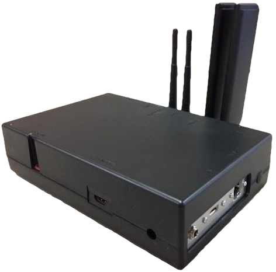

The Black Box device is at its core a gateway device that can relay information to/from devices that are connected to it via various network configuration (wired, wireless, cellular, bluetooth) and I/O protocols (rs485, rs232, modbus).  The device has the ability to display product application information on an HDMI display.  The device in a typical application would be installed in an existing network (wireless, wired, cellular) and would route each product solution's application data from a supported ITW product solution to other devices in that same network or a remote networked cloud solution via a cellular connection.

## DEVICE RESIDENT SOFTWARE SUPPORTED
The Black Box device is in an integral component in several [ITW](https://www.itw.com) product solutions.  The device is uniquely configtured with software and hardware to meet the requirements of each of the ITW solutions below.  The device resident software described below is installed and executes in the Black Box device.

### HOBART SERVICE REMOTE GATEWAY DEVICE
----
This Black Box device resident software supports connecting the [Next Generation Wrapper](https://www.hobartcorp.com/products/weigh-wrap/wrapping-equipment/access-automatic-wrapping-system) and [HT Retail Scales](https://www.hobartcorp.com/products/weigh-wrap/scales/ht-series) to the [Hobart Service](https://www.hobartservice.com) Hobart Service Remote Diagnostics Cloud solution (in pilot beta testing now) over a 4G LTE cellular connection.  This solution allows the [Hobart Service](https://www.hobartservice.com) Product Support team to evaluate all of these connected products remotely via an Internet accessible cloud solution.  [Hobart Service](https://www.hobartservice.com) can troubleshoot issues with the devices remotely in some cases without sending a service technician on-site and can evaluate the problem and recommend parts to be dispatched before sending a service technician on site.

The [Hobart Service](https://www.hobartservice.com) Cloud Solution application interface is shown below:

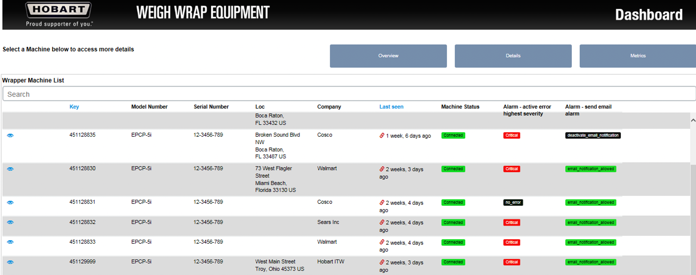

Info on the Hobart Service Cloud solution and its capabilities are available by request.  [Contact Hobart Service](https://www.hobartservice.com/contact-us-hobart-service) for more info.

### HOBART WEIGH WRAP NOW SERVING QUEUEING SYSTEM GATEWAY DEVICE
----
This Black Box device resident software centrally manages a queueing system of customers and routing of application data between multiple HT scales, large screen menuboard display, and a next in line ticketing system kiosk.  The device manages the queueing system and programmatically interacts with each of the devices to efficiently managed queued customers to each of the [HT Retail Scales](https://www.hobartcorp.com/products/weigh-wrap/scales/ht-series) thereby optimizing order fulfillment.

The Now Serving Queueing System components are shown below:

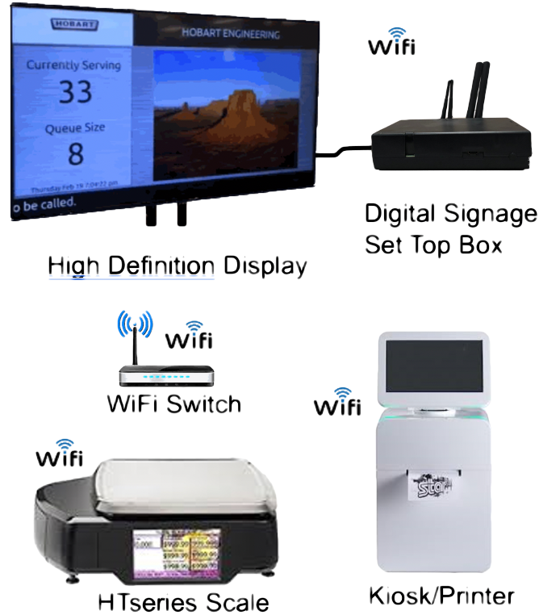

The Now Serving Queueing System solution and its capabilities are available by request. Contact [Hobart Weigh Wrap](https://www.hobartcorp.com/contact-us) for more info.

### PILLAR SYNC CORONA P6000 POWER SUPPLY GATEWAY DEVICE
----
This Black Box device resident software supports display of [Corona P6000 Power Supply](https://www.pillartech.com/surface-treatment/surface-treaters/power-supplies) data via a web browser and the PillarSync device resident application software.  The PillarSync device resident application software provides this data via a web server.  The PillarSync application provides a view of the data via various plots and raw data formats.  The Black Box device can also relay [Corona P6000 Power Supply](https://www.pillartech.com/surface-treatment/surface-treaters/power-supplies) data to other monitoring devices in a wired or wireless network via the [MQTT](https://mqtt.org) protocol.  The Black Box device retrieves data from the Corona P6000 power supply via the RS485 and modbus protocols.  

The PillarSync application interface is shown below:

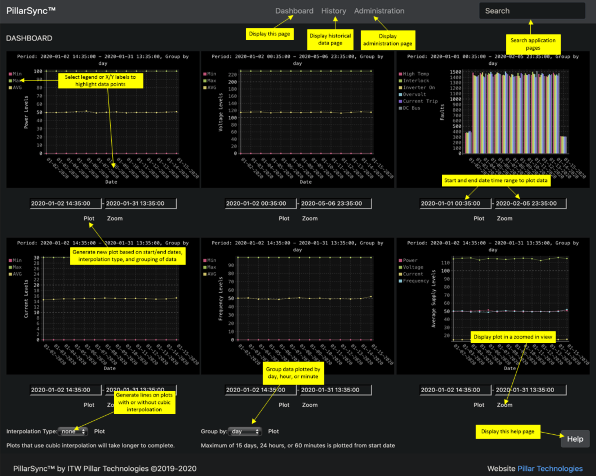

The PillarSync application software and its capabilities are available by request.  [Contact Pillar Technologies](https://www.pillartech.com/surface-treatment/contact-us) for more info.

## HARDWARE
The Black Box device contains a system controller board with configurable network and Input/Output (I/O) components installed to support the ITW device resident software application described in this document. 

### SPECIFICATIONS
#### SYSTEM CONTROLLER
The Black Box Device system controller is configured with the following hardware components:

| COMPONENT | SPECIFICATION |
|---------------|-------------|
| **Processor** | ARM Cortex-A9 1.0 GHz Single Core processor |
| **Memory** | 1 GB DDR3 RAM |
| **Clock** | Battery Backed Real-Time Clock |
| **Display** | HDMI display port |
| **Storage** | 8, 16, and 32 GB Micro SD Card options |
| **Power Supply** | 120 VAC to 24 VDC converter external power supply |
| **Enclosure** | ABS construction with VESA mount |
| **USB** | USB 2.0 port |

#### NETWORK AND I/O DEVICES
The Black Box Device can be configured with the following network and I/O capabilities to support a variety of gateway options to meet the needs of the supported device resident software applications:

* [802.11](https://www.ieee802.org/11/) a/b/g/n/ac Wireless
* [802.3](https://www.ieee802.org/3/) 10/100/1000 Mbps Ethernet Wired
* [LTE](https://en.wikipedia.org/wiki/LTE_telecommunication) Cat 4 cellular modem
* [Bluetooth Low Energy 4](https://www.bluetooth.com/bluetooth-resources/intro-to-bluetooth-low-energy/) 2.4 Ghz wireless
* [RS485](https://en.wikipedia.org/wiki/RS-485)/[RS232](https://en.wikipedia.org/wiki/RS-232) serial protocols ([Modbus](https://modbus.org))
* [CANbus](https://en.wikipedia.org/wiki/CAN_bus) 2.0

#### USB Flash Drive
| COMPONENT | SPECIFICATION |
|---------------|-------------|
| **Size** | 128 MB or larger |
| **Filesystem** | FAT16 or FAT32, **NOTE**: vFat and exFat not supported |
| **USB Connector** | USB Type-A |
| **USB Protocol** | 2.0 |

The USB Flash Drive must be formatted as a FAT filesystem.  To determine if the drive is formatted 
correctly insert the flash drive into the Windows 10 PC and right click on the device letter in 
Windows Explorer and select ***Properties*** from the drop down menu.  The ***File System*** property in the popup window should be ***FAT***.  See figure below for an example of what is displayed.

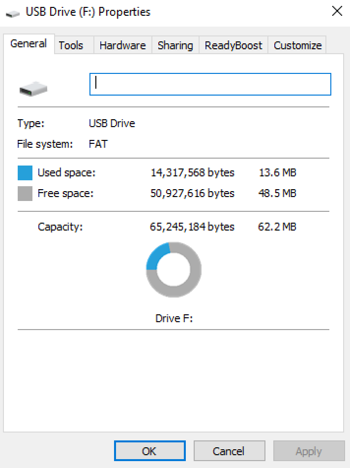

If it is any other type the flash drive needs to
be reformatted with a FAT filesystem via the ***Format...*** drop down item when you right click on the device letter in Windows Explorer.

## GETTING STARTED

### INSTALL ANTENNAS
----
Install all wireless and cellular antennas on the Black Box device as follows:

1. Connect the black wireless and bluetooth cylindrical antennas to each of the device connectors on the side of the unit.  
2. If cellular is supported (required for the Hobart Service Remote Gateway Device) connect the two black cellular paddle antennas to the device enclosure connectors marked cellular on the side of the unit.  See figure below for guidance.

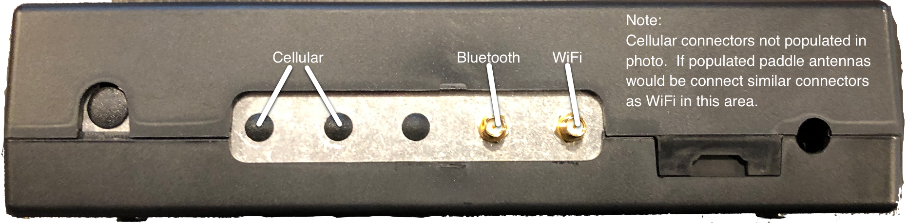

### INSTALL MICRO SD CARD
----
Install a micro SD card if the device resident software application (Pillar Sync requires SD card to be inserted) requires it in the slot of the black box device marked **SD CARD**.  Push the SD card in to the slot gently.  You should feel a slight pressure when the card engages in the slot.  You should not be able to pull it out with your finger if installed correctly.  See figure below for location.

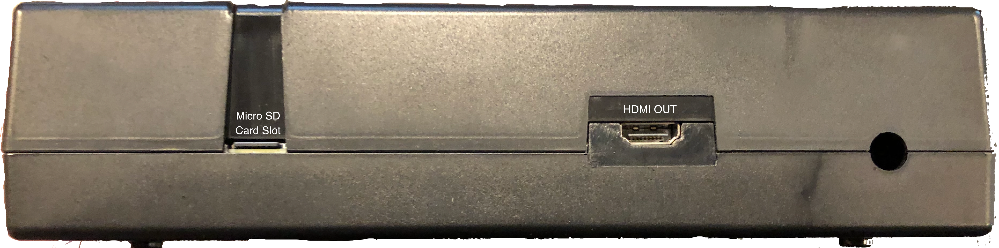

### CONNECT HDMI DISPLAY
----
If the device resident software application (required by Now Serving with Menuboard display) requires an HDMI display to be connected insert an HDMI cable into the **HDMI OUT** on the side of the device.  Connect the other end of the HDMI cable to the HDMI display input connector.

### SUPPLY POWER
----
Supply power to the device as follows:

1. Plug the provided power supply barrel jack connector into the Power Jack of the device.
2. Plug the power supply wall unit into an 120 VAC power outlet.

See figure below for proper power connections to make:

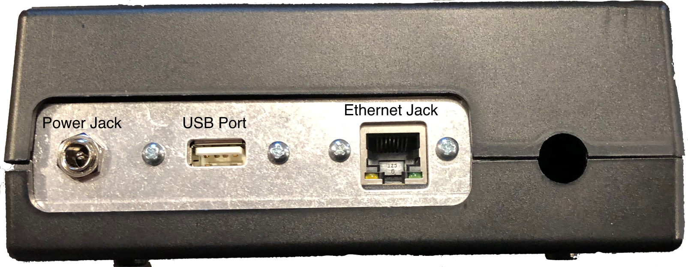

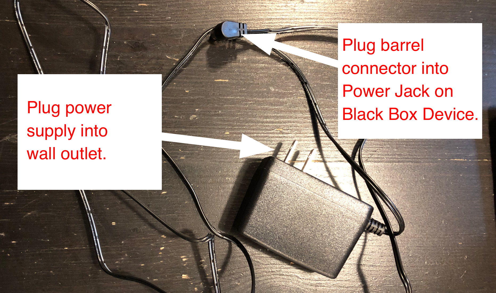

### CONNECT ETHERNET CABLE (wired network configuration only)
----
Connect a CAT5e Ethernet cable to the Ethenet Jack 
CAT5e cables can be purchased with RJ45 connectors to facilitate this.  If a wired Ethernet connection is desired connect the CAT5e cable to the Ethernet Jack marked in the photo above and the other end to the LAN network switch/hub.

### COLLECT NETWORK INFORMATION
----
The Black Box device initially needs to be configured to connect to a Local Area Network (LAN).  This connection can be either wireless via a Wireless Access Point (WAP) or wired via a CAT5e cable connected to a network switch/hub.  
You must consult with the network administrator who manages the WAP or network switch/hub that you wish to connect the device to acquire necessary network configuration parameters for the device to communicate in the LAN.  This will be required in the **BLACK BOX DEVICE SETUP UTILITY SECTION** below in order for the device to communicate on the network.

## BLACK BOX DEVICE SETUP UTILITY
The Black Box Device Setup Utility software is used to configure and install device resident application software on the device as well as to configure network and I/O devices for the supported ITW products.

ITW device resident application software can be obtained via the product support contacts in the **DEVICE RESIDENT SOFTWARE SUPPORTED** section of this document.  Contact [Support](mailto:scott.davis@itwfeg.com) to acquire this software and for specifics on capabilities and release notes.

### REQUIREMENTS
----
This software must be installed on a computing system (laptop or desktop) meeting the following requirements:

| COMPONENT | REQUIREMENT |
|---------------|-------------|
| **Processor** | Intel or AMD processor |
| **Operating System** | Windows 10 (Home or Pro) |
| **Physical RAM** | 8 GB (minimum) |
| **Hard Disk** | 120 MB free space |
| **Wireless Controller** | 802.11 a/b/g/n/ac |
| **Wired Ethernet** | 802.3 compliant RJ45 connector |
| **USB 2.0/3.0** | One available port |

The computing system must be configured to function in the same LAN that the Black Box device will operate within.  The IP address of the computing system should be configured in the same network subnet as the Black Box device once it is configured.

The software requires port 22 and 5076 to be open in Windows Firewall for connectivity to the Black Box device in the network.  Installation of the software package will attempt to open these ports automatically but if not successful consult the Windows administrator managing the Windows computer you are installing the application on to assist in this process.

A USB Flash drive with 10 MB of free space will be required to intiially configure the Black Box device in a wireless or wired Ethernet network.

### INSTALLATION
----
The Black Box Device Setup Utility is installed via a Microsoft Installer package.  The name of the installer package is of the form:

`itw-win-black_box_device_setup_utility-X.X.X.exe`

The X.X.X in the filename is replaced with the specific version of the application you are installing.  The self-extracting executable installer will install on a 32-bit and 64-bit Windows 10 Home or Pro operating system.  

The softare once stored on the Windows 10 computing system hard disk is installed by double clicking on the installer package and responding to some simple prompts to complete the installation.  

Respond to the installation prompts as follows:

When prompted as below to allow the application to install verify that the publisher is ITW Food Equipment Group.  If it is not do not install the application. Otherwise Select **YES** to install the application.

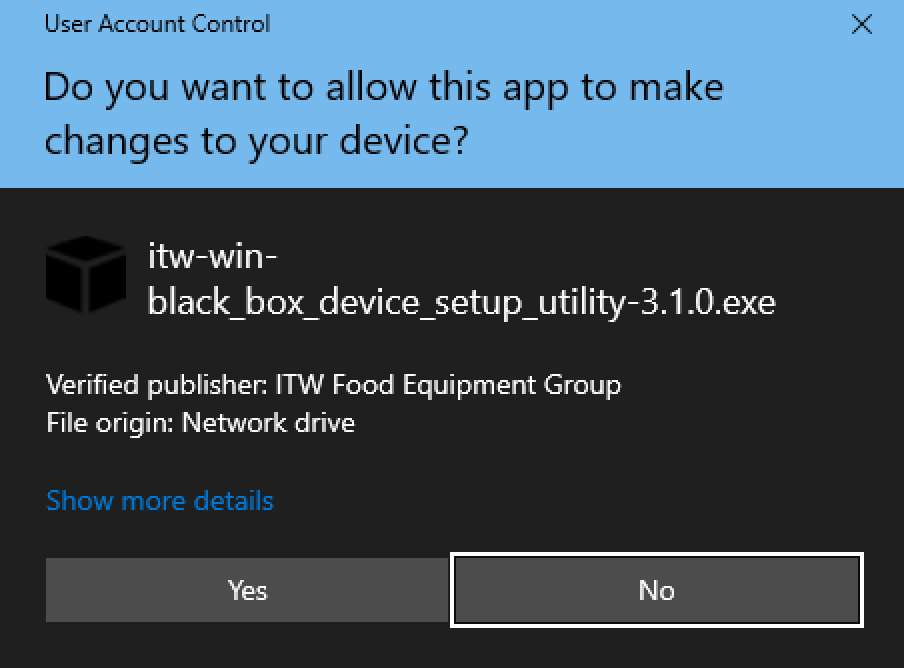

When prompted to select a language as in the figure below select English and select **OK**.

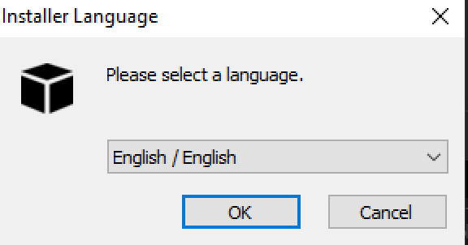

The install welcome dialog will be displayed.  Select **INSTALL** to install the application.

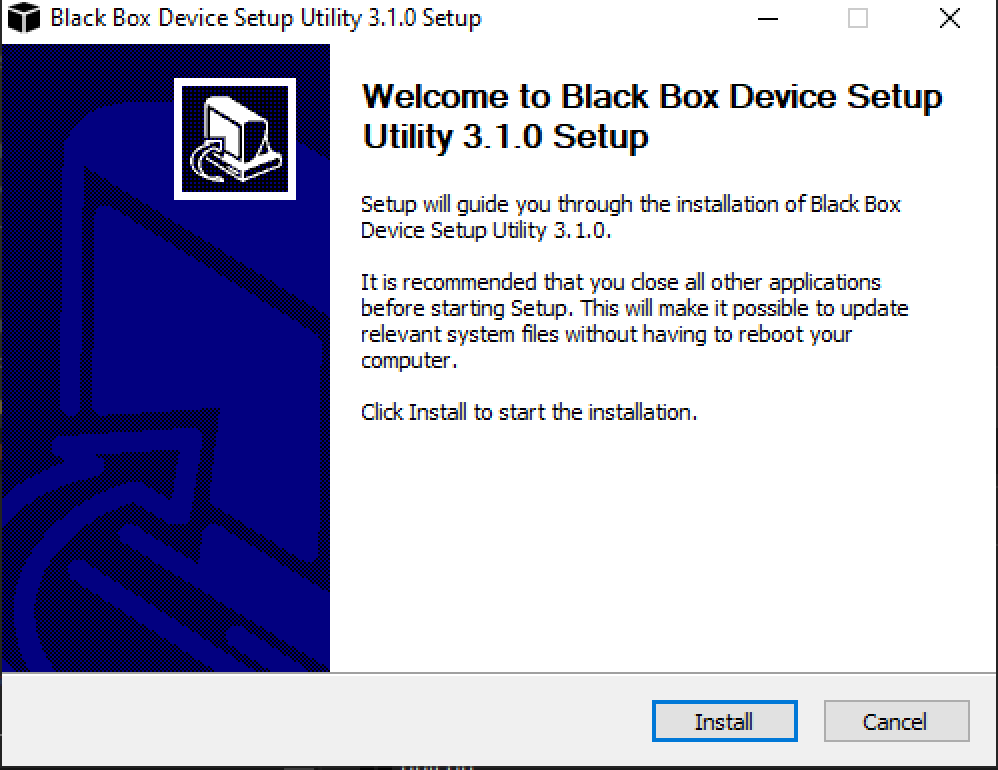

Another dialog will be displayed showing the progress of the install and then the installation complete dialog will be displayed.  Select **FINISH** and the installation will be complete and the Black Box Device Setup Utility will execute and display its user interface.

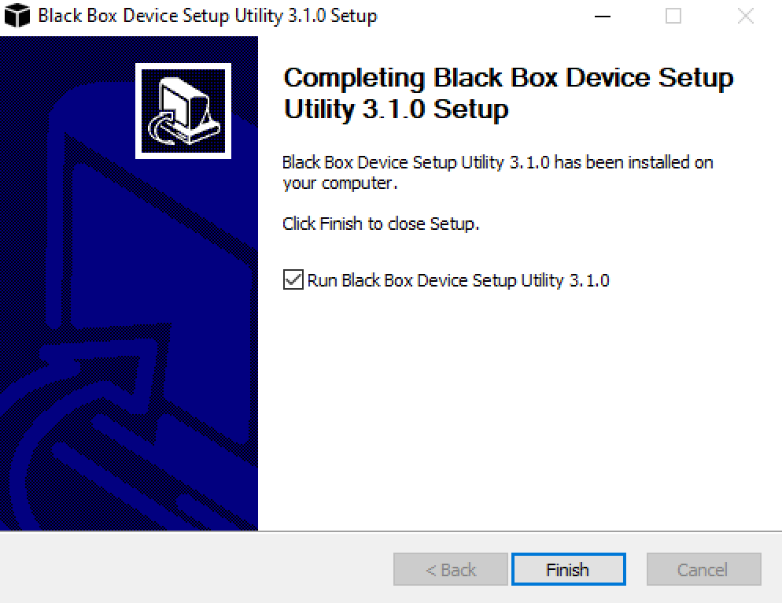

### USING THE SOFTWARE
----
To launch the Black Box Device Setup Utility after it is installed select the Windows menu item **ITW->Black Box Device Setup Utility** from the Start Menu.  See figure below:

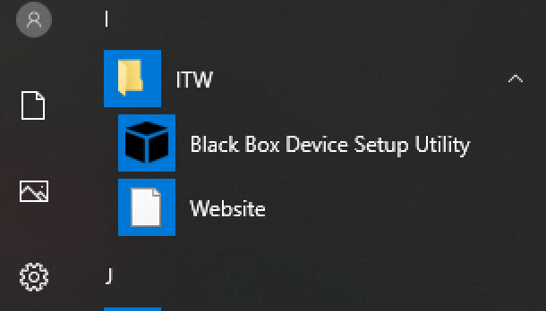

To view the ITW corporate website select **ITW->Website**.

Once launched the Black Box Device Setup Utility user interface, shown in the figure below, supports several functions to enable the device to communicate on a network as well as install and setup device application resident software. 

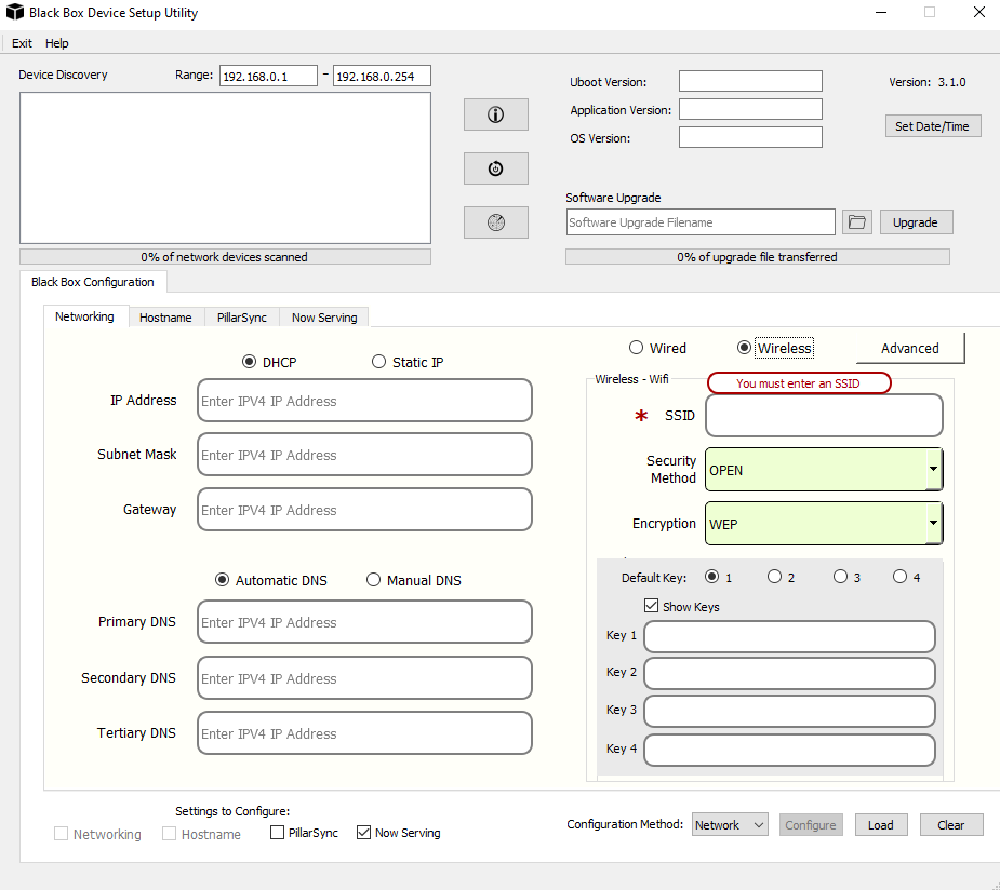

#### FEATURES
----
This software is used to perform the following:

* Configure network and device resident application (Remote Dagnostics Gateway, PillarSync, Now Serving) settings via Disk (USB Flash drive) or over the network with a pre-configured device network accessible device
* Scan and detect devices in the LAN
* Set the current date/time of the device
* Interrogate and inspect software versions installed on a selected device
* Reboot a selected device
* Upgrade the device resident software application

#### CONFIGURATION
----
The Black Box device must be setup on a LAN to enable the gateway device capabilites of its device resident software application.  To do this network settings must be specified.  If you do not know what the network settings should be for the LAN consult with your IT LAN network administrator you wish to connect the Black Box device in.  These settings will be critical to get the device on the network and communicating.  The network settings that are required are located on the Networking Tab under the Black Box Configuration Tab on the user interface.  See figure below of the **Network Tab** for the settings that need configured.  Not all are required.

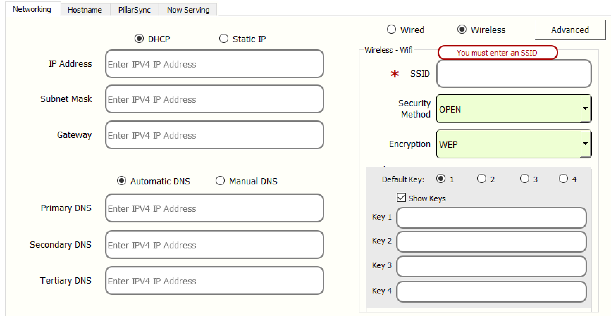

The **Configuration** operations, see Figure below, that are possible include:

* Configure method drop down menu to select configuration via the Network
* Configure method drop down menua to select configuration via Disk (USB Flash Drive)
* Configure button which performs the actual write to Disk of all settings or transmits the settings to a black box device already on present on the LAN
* Load a previously save configuration from Disk (USB Flash Drive)
* Clear or reset all network and device resident application settings to their defaults

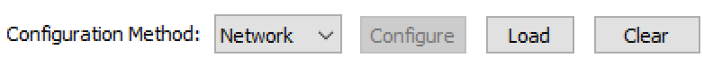

Configurations with details and examples that are possible with this software are described below.

##### NETWORK CONFIGURATION
----
Select the Wired or Wireless radio button located below to select how you want the Black Box device to connect to the LAN.

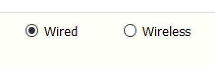

Once the desired selection is made the network settings that must be supplied are present on the screen on the Network Tab.

Supply all of the network settings required and select the **Networking** checkbox in the **Settings to Configure** area so the settings will be included when you configure the device.

###### WIRED CONFIGURATION
----
Select the Wired radio button to display all wired network settings that are possible.  Some are required and will need to be entered.

For example for a wired DHCP network setup select the **Wired** radio button.  

Select the DCHP radio button and Automatic DNS.  All other entries can be left alone.

For a wired static IP address and manual DNS configuration select the Static IP radio button and enter the following:

* IP Address
* Subnet Mask
* Gateway

Select the Manual DNS radio button and enter the following info:

* Primary DNS
* Secondary DNS
* Tertiary DNS

###### WIRELESS CONFIGURATION
----
Select the Wireless radio button to display all wireless network settings that are possible.  Some are required and will need to be entered.

For example for a wireless configuration select the **Wireless** radio button and additional network settings are provided.  

For a wireless DHCP connection enter the following:

* Select the DHCP radio button
* Select the Automatic DNS radio button
* Enter the SSID of the WAP to connect to
* Security method to use for WAP connection
* Encryption method to use for the WAP connection
* Enter any keys required

###### ADVANCED NETWORK CONFIGURATION
----
Advanced Network Configuration is not typically required. To view the advanced settings select the **Advanced** button in the Network tab.

The advanced network settings include:

* Wireless Device Channel setting
* Wireless Device Link Rate selection
* Wireless Device Driver selection
* DNS suffixes assignment

Entering these settings can cause network issues with the Black Box device if not considered carefully.  An IT network administrator and [Support](mailto:scott.davis@itwfeg.com) should be contacted before entering these settings.

##### HOSTNAME CONFIGURATION
----
To configure a network hostname for the Black Box device select the Hostname Tab under the Black Box Configuration tab.  See figure below.  

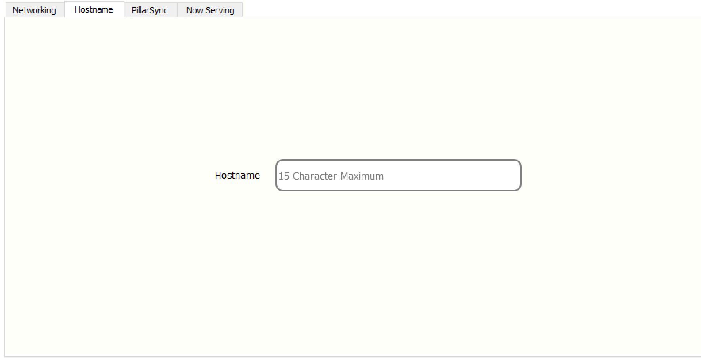

Enter a hostname in the Hostname Text box.  Select the Hostname checkbox under the **Settings to Configure** area of the user interface so this is included in the device configuration when the device programs itself. 

##### PILLARSYNC CONFIGURATION
----
To configure the PillarSync device resident software application settings select the PillarSync Tab on the Black Box Configuration Tab to display the PillarSync application settings that can be configured.  See figure below.

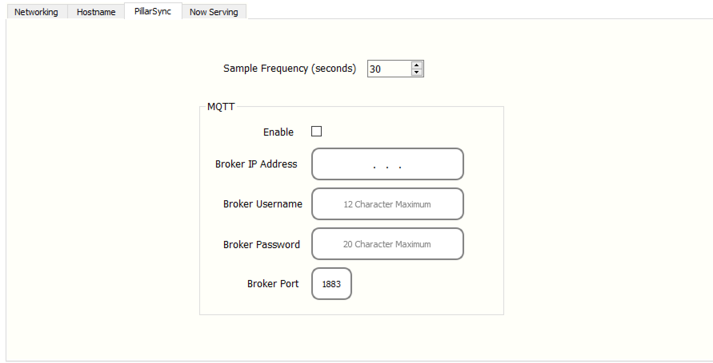

The sample frequency setting established the time in seconds that the Pillar Sync applicaiton should sample over before recording a data point.  The minimum value is 30 seconds.  If PillarSync is to be configured to publish power supply data to an MQTT broker in the LAN select the **Enable** check box and enterh the Broker's IP Address, Username/Password if required to connect to the broker, and the port number that the broker is listening on.  Select the PillarSync checkbox under the **Settings to Configure** area of the user interface so this is included in the device configuration when the device programs itself.

##### NOW SERVING CONFIGURATION
----
To configure the Now Serving device resident software application settings select the Now Serving Tab under the Black Box Configuration Tab.  See figure below.  

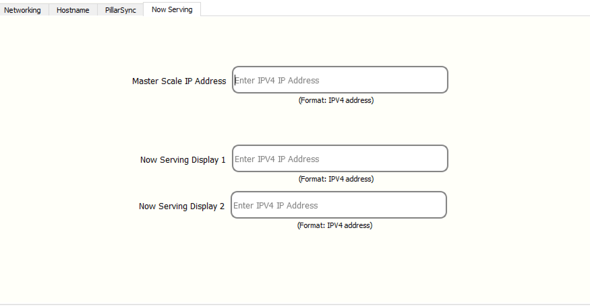

Enter the IP Address of the Master scale, Now Serving Display 1, and the Now Serving Display 2.  See more information on this process in the Now Serving section of the HT Scale Operator's Manual.  Select the Now Serving checkbox under the **Settings to Configure** area of the user interface so this is included in the device configuration when the device programs itself.

##### SETTINGS TO CONFIGURE
----
Once the above network or application settings are specified select the **Network**, **Hostname**, **PillarSync**, or **Now Serving** checkbox under the **Settings to Confgure** area on the user interface based on which settings you want stored in the black box device confiuration.  You must select these checkboxes to ensure the settings get configured.  Refer to the figure below for the location of this area.

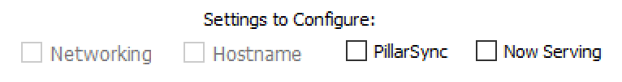

##### CONFIGURE DEVICE
----
Once all configuration settings are specified and the **Settings to Configure** are selected you must select the configuration method.

There are two methods to configure the Black Box device.  The two methods are via **Network** or **Disk**. The option menu location on the user interface and the methods are described below.

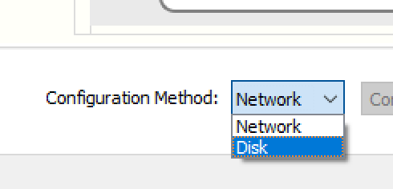

For the first out of the box configuration of the Black Box device the **Disk Configuration** method must be used to initially setup the device on a network.

###### DISK METHOD CONFIGURATION
----
The Disk Configuration method configures the Black Box device via a USB disk or Flash drive.  Insert a USB Flash Drive with 10 MB of free space into the laptop or desktop this software is installed on.  The USB Flash Drive must be formatted with the DOS FAT filesystem.  The USB Flash drive must have a directory named ***autoconfig*** at the root of the filesystem.  Also this is where you must store the ***hdconfig*** file when prompted.  This specific location is loaded by the black box device to configure itself.  See figure below as an example where the USB Flash Drive is mounted as drive ***F:*** on the Windows 10 PC. In the example once the **Configure** button, see below for more info, is pressed the configuration file ***hdconfig*** will be written to ***F:\autoconfig\hdconfig***.

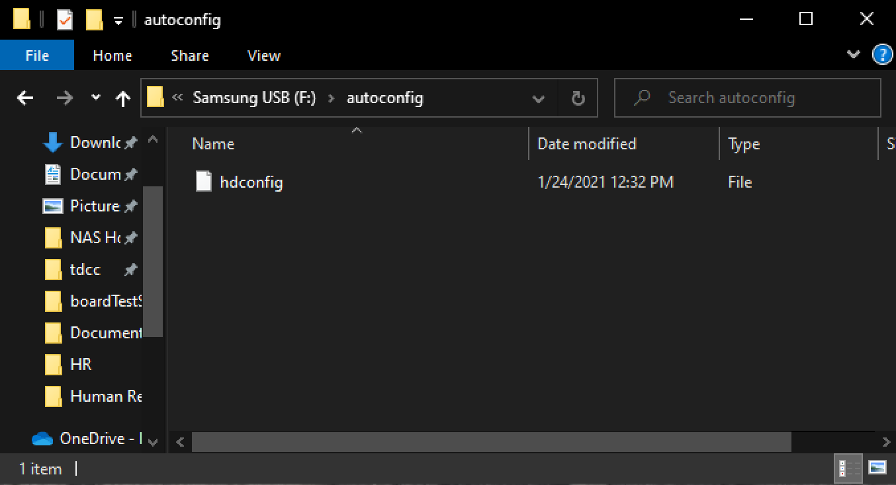

Verify that all of the settings supported by this application are entered and the **Settings to Configure** area has all checkboxes selected that you want to include in the configure operation.  Depress the **Configure** button to write the confguration settings to the USB Flash drive.  The **Configure** button will be disabled if you have not entered any of the settings correctly.  Review your settings and modify until the **Configure** button is enabled.  Once the settings have been written eject the Flash drive from Windows 10 via the proper method.  

Remove the USB Flash Drive and insert it into the powered on Black Box device to configure.  The Black Box device will detect that the USB Flash drive has network settings on it and will automatically configure the device.

**NOTE:
At the completion of the network settings the black box device will beep one time if the settings were successfully configured.  If the device could not be configured correctly such as wireless network could not be associated the device will beep 3 times.**

The black box device may required a reboot and this will be performed automatically if required.

After the device reboots it will connect to the specified network defined by the user of this software if it could be configured correctly, see note above.

At this point the Black Box device can operate as a gateway and if you perform a **Device Discover Scan** the Black Box device should now be present on the network.  

Depending upon the application the Black Box device can also be accessed by other devices in the LAN based on the capabilities of the device resident applicaiton software.  

For example the PillarSync application supports access via a web browser. Once networked futher configuration of the device can occur via the **Network METHOD Configuration** method below.

###### NETWORK METHOD CONFIGURATION
----
The Network Configuration method configures a Black Box device that is already configured and is accessible over a network.  Use the **Device Discovery** option of the the software to determine which Black Box device(s) in the LAN can be configured in this manner.  With this configuration the network and application configuration of a black box device can be altered over the network.  No USB Flash drive is required in this configuration however the black box device must be operational in the LAN.

If the Black Box device is not visible via a **Device Discovery Scan** the **Disk Configuration** method can be repeated to attempt to resolve the issue.

#### DEVICE DISCOVERY
----
Once a Black Box device has been successfully configured via the **Disk** or **Network Method** it can be discovered by this software via the **Scan** button.  See the figure below.  When the **Scan** button is pressed the LAN is scanned to discovery all Black Box devices in the network and if found are listed in the **Device Discovery** list area. In the figure a Black Box device with the IP address of 192.168.0.230 was found in the network.  

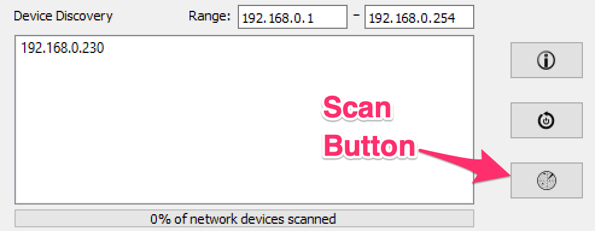

Any Black Box discovered during **Device Discovery** can be selected and the following operations performed:

* **Network Configuration**
* **Device Info**
* **Software Upgrade**
* **Set Date/Time**
* **Reboot Device**

#### DEVICE INFO
----
A Black Box device that was found during **Device Discovery** can be selected and the **Device Info** button pressed to capture the software versions of the device resident software installed. See the figure below for where the device info is displayed.

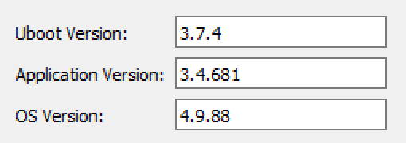

See the figure below for the location of the Device Info button.

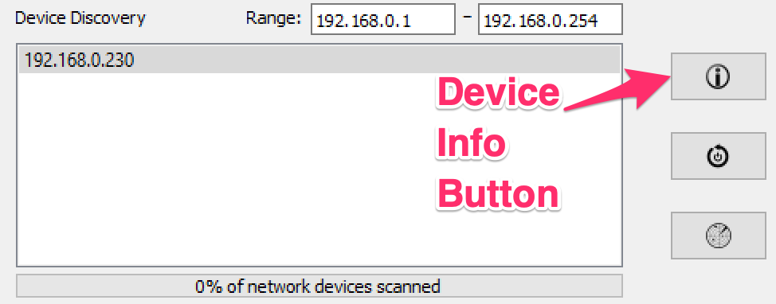

This is useful to determine if you need to perform a software update on the device to add new features or to resolve issues.

#### DEVICE REBOOT
----
A Black Box device that was found during **Device Discovery** can be selected and the **Reboot Device** button pressed to reboot the selected device.  This is helpful if there is an issue with the device and it needs to be reset to its power on state.

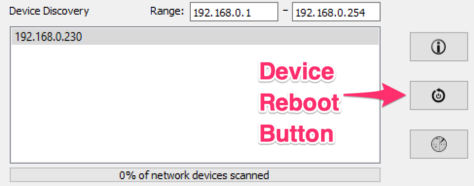

#### SET DATE/TIME
----
A Black Box device that was found during **Device Discovery** can be selected and the **Set Date/Time** button pressed to set the current date/time on the black box device based on the date/time of the Windows computing system this software is executing on.  Verify that the Windows computer has the right date/time for the device before performing this operation.

#### SOFTWARE UPGRADE
----
To update the device resident software application and operating system on a networked black box device that can be found during **Device Discovery** perform the following:

Select the upgrade filename to transmit and install on the black box via the **Software upgrade folder** icon button. See figure below.

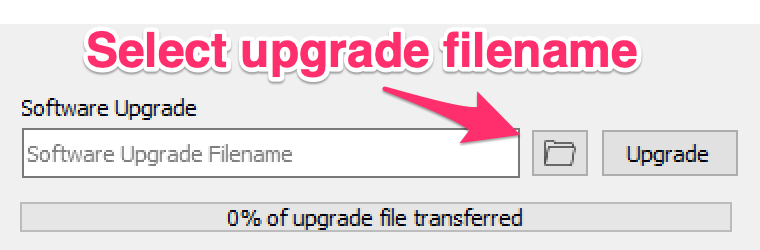

A dialog will be displayed to select the software upgrade file to transmit and install on the device.

Select the **OK** button to register the file to be installed.  Depress the **Upgrade** button and the file selected will be copied to the Black Box device over the network and installed.  

The software upgrade can take quite a bit of time with some install files that over 800 MB in size.  A progress update will occur to let you know how the progress of the install.  

Once the file has been transferred completely the device will install the software.  A subsequent **Device Discovery Scan** can be performed routinely to see if the device is discovered and if so means the upgrade is complete.  Select the device from the device discovery scan and select the **Device Info** button to verify the software versions.

#### HELP
----
Depressing the **Help** menu button displays this help document.

#### EXIT
----
Depressing the **Exit** button exits this software application.

## TROUBLESHOOTING
### SUPPORT
Contact [Support](mailto:scott.davis@itwfeg.com) for help troubleshooting issues with the product.
